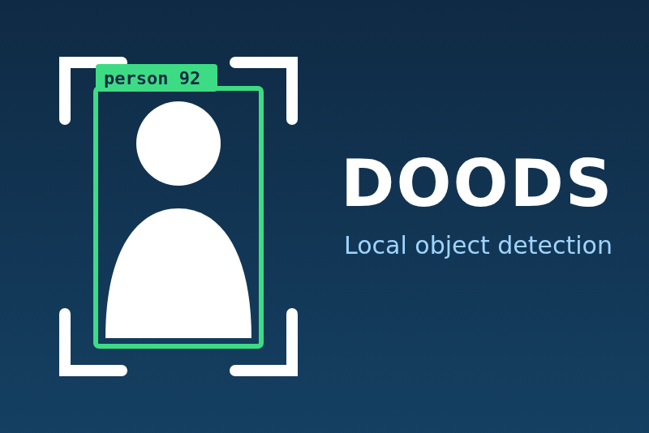

# DOODS for Gladys Assistant



An external integration for [Gladys Assistant](https://gladysassistant.com) that runs the **local
object detection** of [DOODS](https://github.com/snowzach/doods2) (Dedicated Open Object Detection
Service) on the images of your cameras: a person, a car, a cat… without the cloud.

Tested against a real DOODS server in Docker (snowzach/doods2, CPU, `default` tflite and `tensorflow`
detectors) with free photos; developed without real cameras in service: feedback welcome.

## Features

- Up to **four cameras**, each a JPEG snapshot URL (`http://user:password@…/snapshot.jpg`) or an RTSP
  stream that DOODS opens itself.
- **One device per camera**: the analyzed image with the boxes DOODS drew (shrunk to the 150 KB Gladys
  takes), "Object detected" (Yes/No), "Objects detected" ("Person ×2, Car") and one counter per
  searched label.
- Detector, searched labels (or `*`) and minimum confidence, overridable per camera; analysis every
  10 seconds to 1 hour, one camera after the other, or on demand only.
- **Scenes**: "Object detected by DOODS" when an object appears (one event per appearance, filter on
  the objects), "Camera image not read"; the action "Analyze a camera with DOODS" returns the
  objects, counts, persons and confidence to the next actions.
- **Dashboard widget**: the image, the objects, the counts, an "Analyze now" button that a setting
  hides.
- English, French, German and Spanish.

## Requirements

- Gladys 5.1 or later.
- A DOODS server (`docker run -d -p 8080:8080 snowzach/doods2`) reachable from Gladys.
- A snapshot URL or RTSP stream per camera. An external integration cannot read the image of a
  camera another integration put in Gladys.

## Installation

In Gladys: **Integrations → Install from GitHub**, address `https://github.com/guim31/gladys-doods`.
Then fill in the DOODS address and the cameras, run **Check the connection**, and add the cameras from
the **Discovery** tab. The full guide: [docs/en.md](docs/en.md) ([fr](docs/fr.md), [de](docs/de.md),
[es](docs/es.md)).

## How it works

- `GET /detectors` checks the server and the detector; `POST /detect` sends the picture in base64 (or
  the RTSP address) with the searched labels and the minimum confidence, and asks for the picture back
  with its boxes (`image: "jpeg"`).
- HTTP snapshots are downloaded by the integration (credentials in the URL become a Basic header), so
  "camera unreachable" and "DOODS unreachable" stay apart. RTSP streams are read by DOODS (OpenCV), so
  DOODS must reach the camera.
- The returned picture is full size; it is shrunk in a worker thread by a small pure-JavaScript JPEG
  decoder and `jpeg-js` (no native module), within the 256 MB of the sandbox.
- The devices are published with `should_poll: false`: the integration's own timer analyzes the
  devices added in Gladys only, and skips one analyzed on demand less than half an interval ago.
  States are published only when they change, with a heartbeat every 12 hours.

## Checked, and what was not

Checked for real, in Docker: the client against `snowzach/doods2` (detectors list, detections on a
person, cars, a cat and an empty room with the `default` and `tensorflow` detectors, unknown detector,
unreadable image, stream it cannot open, server stopped), and the integration image in the Gladys
sandbox constraints against that server and a test camera serving JPEG snapshots, driven by the fake
Gladys of the SDK. The recorded answers are the fixtures of the tests (`test/fixtures/doods`).

Not checked: real IP cameras (snapshot formats, Digest authentication, RTSP streams in practice), a
GPU DOODS, a real Gladys instance.

## Limits

- Four cameras, eight counted labels per camera, no detection regions.
- One picture per analysis: an object passing between two analyses is missed.
- HTTP Digest authentication is not supported (use the RTSP stream).
- Each analysis costs CPU on the DOODS machine: see the documentation for the interval.

## Development

```bash
npm ci
npm test
npm run lint
npm run format:check
npx github:GladysAssistant/integration-store .
```

See [CLAUDE.md](CLAUDE.md) for the architecture and the rules of the code.

## Credits

- [DOODS2](https://github.com/snowzach/doods2) (MIT, by Zach Brown): its API code (`api.py`,
  `doods.py`, `odrpc.py`) was read to use the API, and its answers were recorded for the tests.
- The detections in `test/fixtures/doods` were recorded on photos from Wikimedia Commons (not in the
  repository): "Cat November 2010-1a" by Alvesgaspar (CC BY-SA 3.0), "2019 Toyota Corolla Icon Tech
  VVT-i Hybrid 1.8" by Vauxford (CC BY-SA 4.0), "A pedestrian walking on the walkway in the University
  of Ilorin" by Timmylegend (CC BY-SA 4.0), "Empty Wall in Living Room" by Pip! Gold (CC BY-SA 2.0).
- The JPEG resizing comes from guim31/gladys-shinobi (Apache 2.0).

This integration is not affiliated with DOODS nor its authors.

## License

[Apache 2.0](LICENSE)
